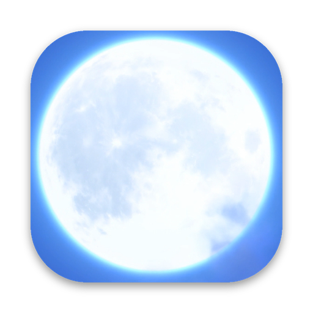

<h1 align="center">月姬新译</h1>

<del>等不了蘑菇了，我们自己做</del>

**月姬新译**是一个非官方的粉丝重制项目：以 2000 年 TYPE-MOON 同人版《月姬》的里线剧本为底本，把画面换成 2021 年重制版《月姬 -A piece of blue glass moon-》的素材，**重制版没有的画面用新生成的内容补齐**，并为**全部台词配上日文语音**，用 Ren'Py 重新实现成可以直接游玩的游戏。

## 目前的内容

- **剧情**：中文剧本，从「近月线（爱尔奎特线、希耶尔线）已通关」开始，收录**翡翠线**和**琥珀线**，以及途中的各个坏结局。暂未收录的线路会提示「本线路尚未收录」。
- **画面**：老版共 811 张图片全部建立了与重制版的对照。能直接替换的用重制版素材；没有对应的背景、立绘和文字图用新生成的内容补齐；部分事件图保留老版。
- **语音**：以重制版角色原声为参考，用声音克隆为老版全部台词生成日文配音，并用语音识别逐句回读检查。
- **界面**：标题画面、系统菜单仿照重制版，使用重制版的界面素材、标题动画和音乐。
- **平台**：macOS 版已打包验证；Windows、Linux 版尚未测试。

## 制作流程

1. **素材对照**：逐张比对老版和重制版图片，记录替换方案和把握程度；缺图按统一原则生成补充素材。
2. **剧本转换**：把老版引擎的剧本（文字、演出指令、选项、变量、跳转）自动转换成 Ren'Py 脚本，素材按对照表替换。
3. **配音**：提取全部台词，标注说话人和情绪，按角色、情绪选参考音频生成语音，语音识别回读，可疑句换随机种子重做。
4. **界面**：按重制版的界面坐标和动画参数复刻标题画面和系统菜单。
5. **测试**：按老版引擎的规则独立模拟原作剧本，搜出到达每个结局和坏结局的选项路线，再让游戏按同样的选项自动跑完，逐个比对经过的流程块和场景，并检查配音文件、通关标记；另做截图检查画面。
6. **打包**：从开发版生成干净的发行副本，排除开发文件和个人存档，替换不能随游戏分发的字体，打包后检查有没有个人信息泄漏，再对打包好的游戏重跑全部路线测试。

## 未来计划

1. **源码放出**：整理转换、测试、打包工具的源码并公开。
2. **完整里线重置**：补上远野家线路中还没收录的秋叶线，完成全部里线。
3. **多语言支持**：在中文之外支持更多语言。
4. **语音、画面增强**：提升配音的情绪表现和准确度，减少保留的老版事件图，补齐和优化生成画面。

## 鸣谢

**原作**

- [TYPE-MOON](https://www.typemoon.com/)：《月姬》（2000）及重制版《月姬 -A piece of blue glass moon-》的剧本、美术、音乐和语音。

**引擎与素材来源**

- [Ren'Py](https://www.renpy.org/)：视觉小说引擎，游戏的运行基础。
- [TsukiREbuild](https://github.com/waifwu/TsukiREbuild)：重制版的网页移植。重制版素材的整理，以及复刻界面所用的坐标和动画参数，都来自这里。
- 月姬REMAKE汉化补丁 v3.0（Letdo1945 及各位译者）：系统菜单的中文界面图。

**画面**

- [GPT Image](https://platform.openai.com/docs/guides/image-generation)（OpenAI）：生成重制版没有的背景、立绘等补充画面。

**语音**

- [Fish Audio S2 Pro](https://huggingface.co/fishaudio/s2-pro)（[Fish Audio](https://fish.audio/)）：声音克隆，生成全部日文配音。
- [Qwen3-ASR](https://huggingface.co/Qwen/Qwen3-ASR-1.7B)（通义千问）：语音识别，逐句回读检查配音。
- [SGLang-Omni](https://github.com/sgl-project/sglang-omni)：部署上面两个模型的推理服务。

**字体**

- [思源黑体](https://github.com/adobe-fonts/source-han-sans)（Adobe、Google，SIL 开源字体许可）：游戏正文和界面字体。

## 声明

- 本项目是非官方、非商业的粉丝作品。
- 本项目仅供个人学习交流。请支持正版。
